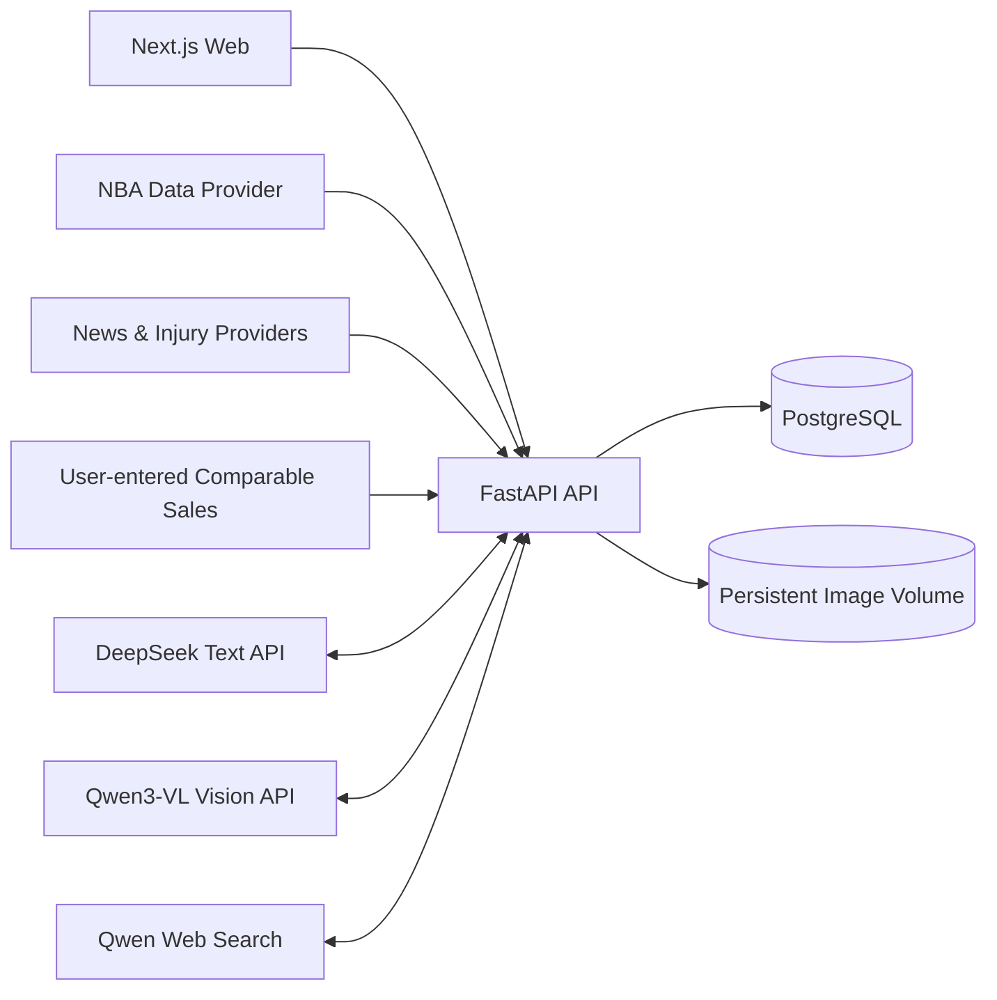

# 系统架构

## 1. 设计原则

- **账本优先**：买入价和盈亏必须来自交易流水，不把可变的汇总数字当作事实源。
- **卡片与持仓分离**：同一张卡的产品定义只保存一次，个人可以持有多张不同品相、编号或评级的实例。
- **时间序列保留**：估值、球员表现和评分均保存快照，支持复盘“当时为什么买”。
- **建议可解释**：评分保存各因子、权重、输入数据和模型版本，AI 文本不能覆盖结构化结论。
- **外部源可替换**：NBA、新闻、伤病和市场成交价通过 provider adapter 标准化后入库。

## 2. 逻辑架构



当前部署为模块化单体：Web 与 API 分进程运行，共享 PostgreSQL；同步任务由显式 API 调用触发。数据量增长后，可将 provider 同步迁移到队列 worker，而不改变领域表结构。

## 3. 后端模块边界

| 模块 | 职责 | 关键对象 |
|---|---|---|
| catalog | 球员、品牌、产品、卡种定义 | player, brand, card_set, card_definition |
| portfolio | 个人卡片实例与交易账本 | collection_item, transaction |
| valuation | 当前估值、可比成交和价格历史 | valuation_snapshot, market_comp |
| intelligence | 比赛数据、新闻、伤病与球队环境 | player_metric, player_event |
| scoring | 因子归一化、加权及版本管理 | scoring_model, card_score |
| advisory | 买入评级、持有期、目标区间 | analysis_request, recommendation |
| ingestion | 外部 provider 同步、去重与溯源 | data_source, external_reference |

模块间通过应用服务调用。HTTP handler 不直接写 SQL；外部 provider 数据先标准化，再进入领域表。

## 4. 核心计算

### 成本

每笔交易保存原币金额、币种和入账汇率；组合基准币默认 CNY。

```text
净投入 = 买入总额 + 买入费用 - 卖出总额 + 卖出费用
持仓数量 = 买入数量 - 卖出数量
```

单张实体卡首版通常数量为 1。数据库仍支持批量买入，未来可处理 lot。

### 当前估值与盈亏

```text
当前市值 = 最新有效估值 × 持仓数量
未实现盈亏 = 当前市值 - 剩余成本
已实现盈亏 = 卖出净收入 - 被卖出份额成本
```

MVP 使用移动加权成本；后续可按配置支持 FIFO 和逐卡成本法。

### 评分

所有因子先归一化为 0–100，再按模型版本加权：

```text
总分 = 历史地位×20% + 当前表现×20% + 年龄潜力×15%
     + 卡种稀缺度×20% + 品牌等级×10% + 市场热度×15%
```

这只是初始权重。系统会针对收藏策略增加 profile modifier：高端品牌低价球员、RC 潜力股、历史球星资产卡分别使用独立配置，而不是悄悄改变基础分。

## 5. AI 分析流程

1. 输入卡片字段、图片或已有持仓；
2. 匹配卡片定义和近期可比成交；
3. 生成球员与卡片结构化评分；
4. 计算估值区间和相对买入价偏差；
5. AI 只基于上述证据生成解释、风险和催化剂；
6. 保存建议、证据快照、模型版本和生成时间。

输出结构固定为：合理价格区间、买入评级、建议持有期、目标卖出区间、置信度、关键依据、主要风险。

## 6. 安全与演进

- 金额使用 `numeric`，不使用浮点数。
- 所有时间用 `timestamptz`，展示层转换时区。
- 重要业务表使用 UUID，并保留 created_at / updated_at。
- API 层未来接入 OAuth；当前数据库已包含 owner_id，避免单用户假设扩散。
- 原始 provider payload 保存于 JSONB，结构化字段用于查询和评分。
