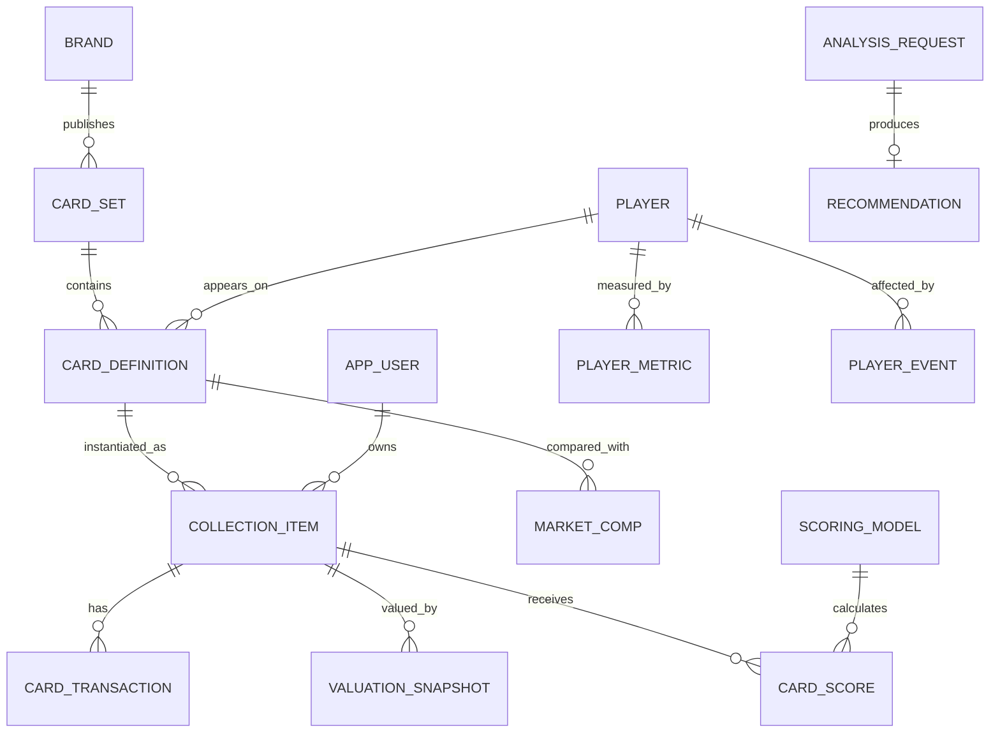

# 数据模型

## 1. 实体关系

## 2. 三层卡片模型

- `card_set`：某品牌某赛季产品线，例如 2022-23 National Treasures Basketball。
- `card_definition`：产品 checklist 中的卡定义，例如某球员 Rookie Patch Autographs /99。
- `collection_item`：收藏者手里的具体实体，例如 serial 23/99、PSA 9、带图片和备注。

RC、Auto、Patch 不是互斥的单选“卡种”。首版以布尔特征保存，允许一张 RPA 同时为 rookie、autograph、patch；平行版和具体 insert 用文本字段描述。

## 3. 估值来源优先级

1. 可验证的近期成交 comps；
2. 多个挂牌价折价后的区间；
3. 用户手工估值；
4. AI 推断。

`valuation_snapshot` 记录最终采用值，`market_comp` 保存证据。当前估值是最新快照，不在持仓表重复维护。

## 4. 用户案例映射

初始案例将作为后续开发种子数据，而不是混入 reference migration：

| 卡片 | 成本 | 策略标签 |
|---|---:|---|
| Jalen Duren NT Auto | 260 | 高端品牌低价球员 / 潜力 |
| Shaedon Sharpe Crown Royale Silhouettes Auto | 210 | RC 潜力股 |
| Brandon Ingram One and One Auto | 230 | 高端品牌低价球员 |
| Kobe 1996-97 UD3 Hardwood Prospects | 550 | 历史球星资产 |
| Steve Nash 1996-97 UD3 Hardwood Prospects | 40 | 历史球星资产 / 低价 |

币种暂不猜测；录入时必须明确 CNY 或 USD。年份、编号、是否 RC 等也需要按卡面或 checklist 确认。
